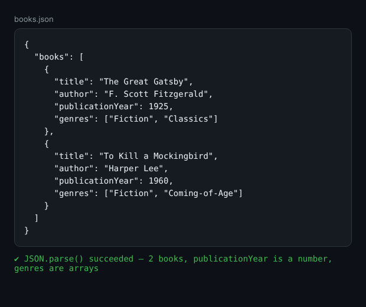
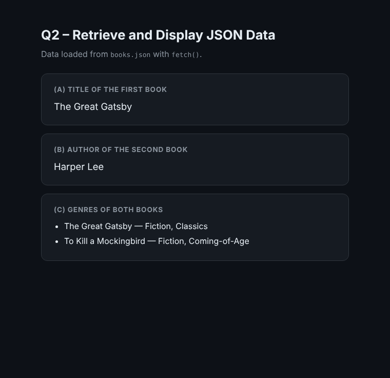
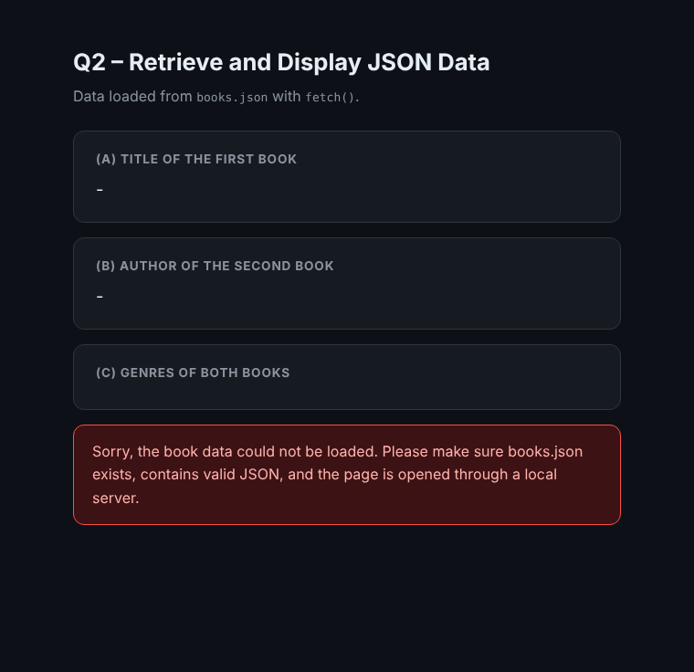
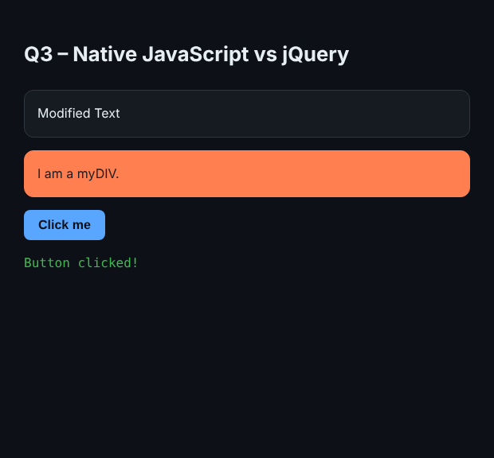

# BIC21203 Lab 4b – Client-Side Scripting (JSON and jQuery)

**Name:** Muhammad Muaz Zikri bin Mohd Zuhdi
**Student ID:** AI240292
**Course:** BIC21203 Web Development, UTHM

## Files

| File | Question | What it does |
|---|---|---|
| `books.json` | Q1 | Valid JSON with a top-level `books` array of two book objects |
| `books.html` | Q2 | Loads `books.json` with `fetch()` and displays selected data on the page |
| `jquery-dom.html` | Q3 | jQuery 4.0.0 equivalents of three native DOM operations |
| `screenshots/` | – | Test evidence |

## Setup (local server required)

`fetch()` cannot load local files over `file://`, so run the pages through a local server.

**Option A – VS Code Live Server**
1. Open this folder in VS Code.
2. Install the **Live Server** extension (by Ritwick Dey).
3. Right-click `books.html` and choose **Open with Live Server**.
4. Open `jquery-dom.html` the same way.

**Option B – Python**
```bash
python -m http.server 5500
```
Then visit `http://localhost:5500/books.html` and `http://localhost:5500/jquery-dom.html`.

An internet connection is needed for `jquery-dom.html`, because jQuery is loaded from the official CDN (`https://code.jquery.com/jquery-4.0.0.min.js`, full build).

## Q1 – books.json

Each book has `title` (string), `author` (string), `publicationYear` (number) and `genres` (array of strings). Property names use double quotes and there are no trailing commas. The file parses successfully with `JSON.parse()`.



## Q2 – books.html

`loadBooks()` uses `async/await`:
1. `fetch("books.json")` requests the file.
2. `response.ok` is checked, because `fetch()` does not reject on HTTP errors like 404.
3. `response.json()` parses the data (throws on invalid JSON).
4. The structure is checked, then values are written with `textContent` and `createElement()`.
5. Any failure is caught and a friendly error message is shown on the page.

Output: **The Great Gatsby**; **Harper Lee**; The Great Gatsby — Fiction, Classics; To Kill a Mockingbird — Fiction, Coming-of-Age.




## Q3 – jquery-dom.html

| Native JavaScript | jQuery |
|---|---|
| `document.getElementById("myElement").textContent = "Modified Text";` | `$("#myElement").text("Modified Text");` |
| `document.querySelector("#myDIV").classList.add("myStyle");` | `$("#myDIV").addClass("myStyle");` |
| `document.getElementById("myButton").addEventListener("click", () => alert("Button clicked!"));` | `$("#myButton").on("click", function () { alert("Button clicked!"); });` |


